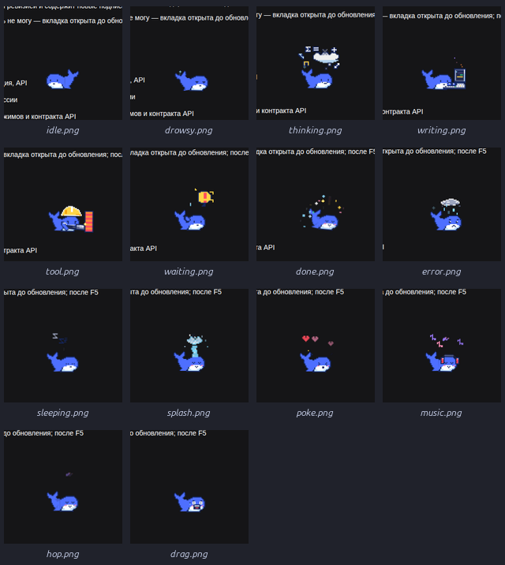
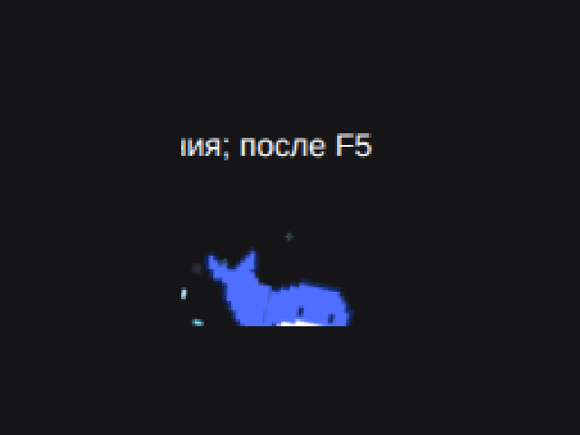

# dsh-pixel-whale-pet

Пиксельный китёнок для веб-UI **DeepSeek Harness**: плавает по свободному месту в колонке чата, уплывает от текста и курсора, реагирует на все стадии работы агента и его todo-задачи, а иногда хулиганит — пускает фонтан, «чиллит» в наушниках или устраивает салют.





## English (summary)

A pixel whale calf for the DeepSeek Harness web UI. It swims through empty space in the chat, dodges message text and the cursor, follows every agent stage (thinking, streaming, tool calls, waiting, done, error, sleep) and todo progress, and occasionally misbehaves: spouts water, wears headphones or launches a colorful firework when a turn completes. Client-only browser plugin: nothing on the host side, no services or tools.

## 中文（简介）

DeepSeek Harness 网页 UI 的像素小鲸鱼宠物：在聊天区空白处游动，躲开消息文字和鼠标指针，跟随智能体的每个阶段（思考、输出、工具调用、等待、完成、出错、睡觉）和任务进度切换动作，偶尔还会喷水、戴耳机听歌，或在回合完成时放一场彩色烟花。纯前端插件，无需后端服务与工具。

## Состояния

| Состояние | Когда | Что делает |
|---|---|---|
| `idle` | агент простаивает | медленно плавает, виляет хвостом, моргает |
| `drowsy` | засыпает | полуприкрытые веки, сонный дрейф |
| `sleeping` | простой больше минуты | спит, Zzz |
| `thinking` | модель думает | облако мысли, формулы, тихий разговор ртом и моргание |
| `writing` | стримится текст | печатает на ноутбуке, строки кода мигают |
| `tool` | выполняется инструмент | в каске стучит молотком по панели, искры |
| `waiting` | ждёт ответа/подтверждения | пузырь «!», машет плавником |
| `done` | турн завершился | прыжок, румянец и большой разноцветный салют |
| `error` | турн упал | серая туча с каплями, грустная морда |
| `splash` | шалость в простое | короткий пуф из дыхала, затем высокий фонтан-«ива» с брызгами |
| `music` | «чиллит» | наушники и ноты |
| `poke` | клик по китёнку | сердечки и румянец |
| `drag` | перетаскивание мышкой | шуточно ругается, широко открывая рот |
| `hop` | хулиганство/удар о стену | подскок со squash/stretch |

Плюс модификатор `is-fast` — быстрый хвост и след из пузырей при убегании.

## Уклонение от текста

Раз в ~160 мс китёнок собирает строчные прямоугольники видимого текста и область композера, выбирает цели только вне них, а при наезде текста или близком курсоре ускользает в свободную нишу. При изменении размера чата (сайдбар, зум, композер) не телепортируется, а подплывает, и помнит позицию между перезагрузками.

## Установка

Плагин — bundle для профиля `web` в DeepSeek Harness. Склонируйте репозиторий и подключите каталог как bundle в профиль (например, через плагин-менеджер DSH или `link:`-зависимость в `~/.dsh/profiles/web/package.json`), затем включите строку плагина в профиле.

`client.js` уже собран и лежит в репозитории. Пересборка после правок арта/движка:

```bash
node scripts/build.mjs
```

Затем обновите вкладку Web-UI.

## Структура

```
src/art.js      — SVG-арт китёнка и CSS-анимации состояний
src/engine.js   — клиентский движок: плавание, уклонение, монитор стадий чата
scripts/build.mjs — склеивает src/*.js в client.js
docs/           — превью и картинки для README
locale/         — подписи en/ru/zh
```

## Благодарности

Арт вдохновлён спрайтами питомца Deepy из [dsh-go](https://github.com/ccch1mneyyy/dsh-Go) (idle/typing/thinking/music/building и др.).

## Лицензия

MIT
